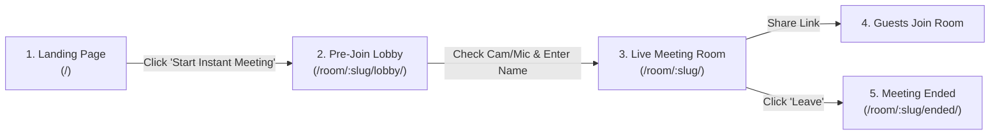

# 02 — Business & Product Overview

## 2.1 The Problem Space
In the modern workplace, remote communication frequently suffers from three major pain points:
1. **Meeting Start Delay:** Teams report losing between 5 to 10 minutes at the start of meetings troubleshooting client app installations, mandatory updates, and login password resets.
2. **Platform Incompatibility:** Clients on locked-down enterprise laptops often cannot install external desktop apps (e.g., Zoom or MS Teams desktop executables) due to corporate IT policies.
3. **Application Bloat:** Most conferencing suites bundle unnecessary features (file drives, team channels, calendar syncs, chatbots) that slow down page loads and clutter the interface.

## 2.2 The Solution
Teams focuses strictly on the meeting itself:
- Instant room creation via unique, collision-free 9-character slugs (`abc-defg-hij`).
- Direct URL access that functions seamlessly in Chrome, Edge, Brave, Safari, and Firefox.
- In-browser device preview lobby allowing participants to check hair, camera framing, and microphone levels before broadcasting their feed.
- Clean floating glass interface keeping user focus on the conversation.

## 2.3 Core User Journey

1. **Discovery & Room Creation:** Host visits the platform and clicks **Start Instant Meeting** (or creates a room from their **Host Dashboard**).
2. **Device Verification:** User enters the **Pre-Join Lobby**, where the browser requests camera and microphone permissions. The live audio level meter pulses with voice input.
3. **Active Meeting:** User enters the live room. WebRTC peer connections establish automatically. Participants can toggle mute, video, screen share, and send chat messages.
4. **Call Termination:** When finished, user clicks **Leave** (or host clicks **End for All**), redirecting to the **Meeting Ended** summary page.
