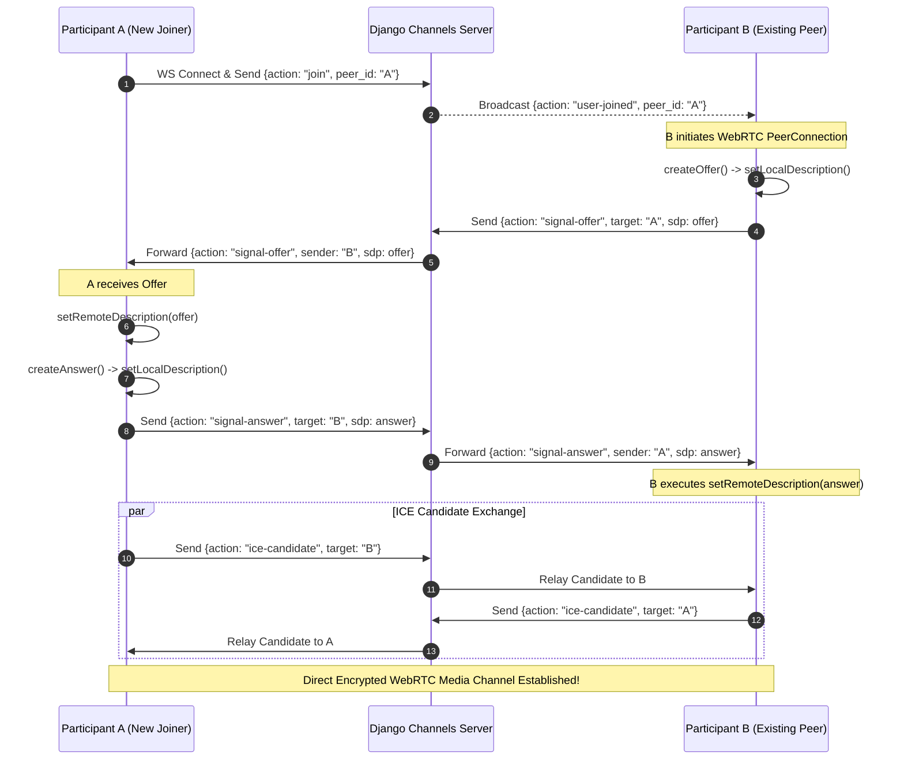

# 05 — System Architecture & WebRTC Signaling

## 5.1 Architectural Blueprint

```mermaid
graph TD
    subgraph Clients["Browser Clients (Peers)"]
        ClientA["Participant A (Host)"]
        ClientB["Participant B (Guest)"]
    end

    subgraph Edge["Reverse Proxy Layer"]
        Nginx["Nginx (Port 80/443)<br/>SSL Termination + Static Asset Caching"]
    end

    subgraph Backend["Application Server (ASGI)"]
        Daphne["Daphne ASGI Server (Port 8000)"]
        DjangoViews["Django HTTP Views<br/>(Auth, Rooms, Dashboard)"]
        ChannelsRouter["Channels WebSocket Router<br/>(ProtocolTypeRouter)"]
        MeetingConsumer["MeetingConsumer<br/>(WebRTC Signaling + Chat)"]
    end

    subgraph Data["Persistence & Layering"]
        DB[(SQLite / PostgreSQL)]
        ChannelLayer["Channels InMemory / Redis Layer"]
    end

    ClientA -->|HTTP & WS Requests| Nginx
    ClientB -->|HTTP & WS Requests| Nginx
    Nginx -->|Proxy Pass| Daphne
    Daphne --> DjangoViews
    Daphne --> ChannelsRouter
    ChannelsRouter --> MeetingConsumer
    MeetingConsumer <--> ChannelLayer
    DjangoViews <--> DB

    ClientA <==>|Direct P2P WebRTC Audio/Video (DTLS/SRTP)| ClientB
```

## 5.2 WebRTC Signaling Sequence

WebRTC requires an out-of-band communication channel (Signaling) for peers to exchange session descriptions (SDP) and network routing candidates (ICE). Teams uses Django Channels WebSockets for this handshake:



## 5.3 STUN/TURN Configuration
For direct peer-to-peer connection across NAT routers and firewalls, Teams configures public Google STUN servers:
- `stun:stun.l.google.com:19302`
- `stun:stun1.l.google.com:19302`
- `stun:stun2.l.google.com:19302`
For strict symmetric enterprise firewalls, standard TURN credentials can be configured directly inside `static/js/meeting.js` in the `rtcConfig` object.
