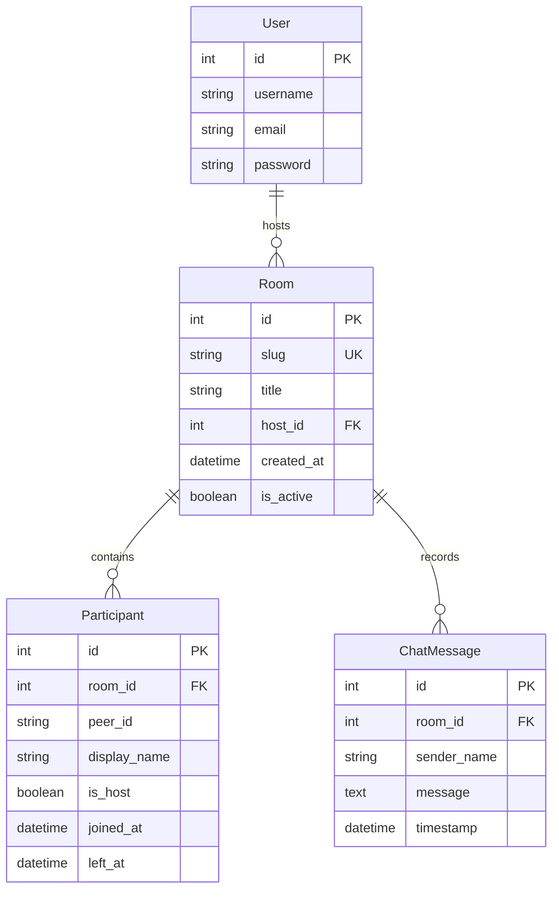

# 06 — Data Model & Schema Reference

## 6.1 Entity-Relationship Diagram

## 6.2 Model Specifications (`meeting/models.py`)

### 1. Room Model
Represents an individual meeting instance.
| Field | Type | Attributes | Description |
|---|---|---|---|
| `id` | BigAutoField | Primary Key | Internal record identifier. |
| `slug` | CharField(24) | `unique=True`, `db_index=True` | Unique URL-safe room slug (e.g., `abc-defg-hij`). |
| `title` | CharField(150) | `default="Instant Meeting"` | Custom meeting topic chosen by host. |
| `host` | ForeignKey(User) | `null=True`, `on_delete=SET_NULL` | The registered user who owns the meeting. |
| `created_at`| DateTimeField | `auto_now_add=True` | Timestamp when the room was initialized. |
| `is_active` | BooleanField | `default=True` | Toggled to False when meeting is terminated. |

### 2. Participant Model
Tracks attendees who join a room session.
| Field | Type | Attributes | Description |
|---|---|---|---|
| `id` | BigAutoField | Primary Key | Session identifier. |
| `room` | ForeignKey(Room) | `on_delete=CASCADE` | Associated Room reference. |
| `peer_id` | CharField(64) | `db_index=True` | Ephemeral client WebRTC peer identifier. |
| `display_name` | CharField(60) | Required | Name shown on participant tile and in chat. |
| `is_host` | BooleanField | `default=False` | Indicates whether attendee holds host moderation rights. |
| `joined_at` | DateTimeField | `auto_now_add=True` | Entry timestamp. |
| `left_at` | DateTimeField | `null=True`, `blank=True` | Timestamp when user closed call. |

### 3. ChatMessage Model
Persists messages exchanged during an active call.
| Field | Type | Attributes | Description |
|---|---|---|---|
| `id` | BigAutoField | Primary Key | Message identifier. |
| `room` | ForeignKey(Room) | `on_delete=CASCADE` | Associated Room. |
| `sender_name` | CharField(60) | Required | Display name of the author. |
| `message` | TextField | Required | Sanitized message content. |
| `timestamp` | DateTimeField | `auto_now_add=True` | Sent timestamp. |
